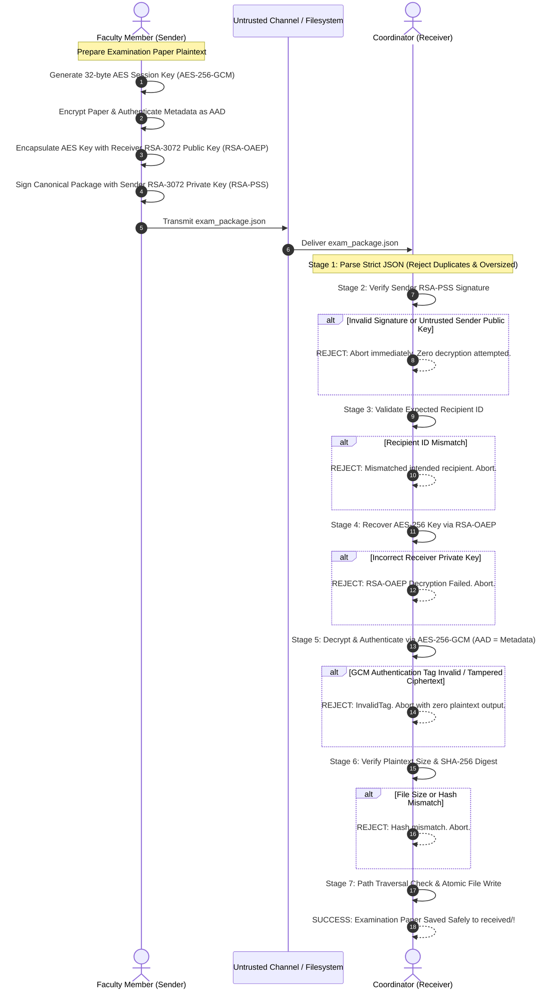

# Secure Examination-Paper Exchange Using Python
**Protocol Name:** `SecureExamExchange` | **Version:** `1`  
**Target Platform:** Windows 10/11, Python 3.11+, VS Code, Jupyter Notebook  
**Repository:** [GitHub Repository](https://github.com/Ayush-0108/Secure-Examination-Paper-Exchange-Using-Python.git)

---

## 1. System Overview & Security Objectives

This project implements the complete cryptographic architecture for the college cybersecurity workshop **Secure Examination-Paper Exchange Using Python**. The system enables confidential examination papers to be transferred from an authorized faculty member (**Sender**) to an examination coordinator (**Receiver**) over untrusted communication channels.

The system enforces a **strict fail-closed architecture**: under no circumstances is partial or unauthenticated plaintext released or saved to disk if any cryptographic, protocol, or metadata check fails.

### Core Cryptographic Guarantees:
- **Confidentiality:** The examination paper is encrypted with **AES-256-GCM**. The 32-byte AES session key is encapsulated using **RSA-OAEP-SHA256** with the receiver's 3072-bit public key. Only the legitimate coordinator holding the matching private key can recover the session key.
- **Sender Authentication & Non-Repudiation:** The complete package is signed with the faculty member's RSA-3072 private key using **RSA-PSS-SHA256**. The receiver verifies this signature before attempting any private-key decryption.
- **Integrity & Authenticity:** AES-256-GCM computes a 16-byte authentication tag over the ciphertext and associated data (AAD). Any modification to the ciphertext, nonce, tag, or metadata causes immediate rejection (`InvalidTag`).
- **Metadata Binding (AAD):** Canonical JSON bytes of the complete metadata object (including sender ID, recipient ID, original filename, file size, and plaintext SHA-256) are authenticated as AES-GCM Associated Data.
- **Strict Parsing & Fail-Closed Enforcement:** Enforces UTF-8 canonical JSON, rejects duplicate JSON keys, rejects invalid Base64, blocks path traversal attempts, and prevents silent overwriting of existing examination papers.

---

## 2. Directory Layout

The project is structured into two modular components:

```
Secure Examination-Paper Exchange Using Python/
├── sender/                               # SENDER COMPONENT (Faculty Member)
│   ├── sender_secure_exam_exchange.ipynb # Sender interactive Jupyter Notebook
│   ├── run_sender.py                     # Sender terminal runner & 15-test audit suite
│   └── build_notebook.py                 # Sender notebook generator
│
├── receiver/                             # RECEIVER COMPONENT (Examination Coordinator)
│   ├── receiver_secure_exam_exchange.ipynb # PRIMARY DELIVERABLE: Receiver Jupyter Notebook
│   ├── secure_exam_receiver.py           # Core receiver cryptographic module & 7-stage pipeline
│   ├── run_tests_and_report.py           # Receiver security test runner (20/20 tests passed)
│   ├── build_notebook.py                 # Receiver notebook generator
│   ├── validate_notebook_execution.py    # Automated headless notebook test validator
│   ├── create_demo_package.py            # Demo asset generator
│   ├── tests/
│   │   ├── test_receiver_security.py     # Automated pytest security suite (Tests A through I)
│   │   └── test_helpers.py               # Sender protocol simulator for testing
│   └── secure_exam_exchange/
│       ├── keys/
│       │   ├── receiver_private.pem      # PKCS#8 encrypted RSA-3072 private key
│       │   └── receiver_public.pem       # SubjectPublicKeyInfo PEM receiver public key
│       ├── sender_public_keys/
│       │   └── sender_public.pem         # Trusted faculty RSA-3072 public key
│       ├── incoming/
│       │   └── paper_pkg_...json         # Incoming encrypted examination package
│       ├── received/
│       │   └── paper.txt                 # Authenticated, decrypted plaintext examination paper
│       ├── test_results/
│       │   └── receiver_test_results.txt # Formal security audit report
│       └── sample_data/
│           └── sample_exam.txt           # Synthetic confidential examination paper
│
├── .gitignore                            # Secret safety: private keys are NEVER committed
├── .venv/                                # Python 3.11 virtual environment
└── README.md                             # Comprehensive project documentation
```

---

## 3. Protocol Architecture & Sequence of Events



---

## 4. How to Run the Project

### Receiver Side:
1. Open [`receiver/receiver_secure_exam_exchange.ipynb`](file:///d:/Ayush_Files/Users/kumar/Secure%20Examination-Paper%20Exchange%20Using%20Python/receiver/receiver_secure_exam_exchange.ipynb) in VS Code.
2. Select the `.venv` Python 3.11 kernel.
3. Click **Run All** to verify the incoming package and execute the 20 automated security tests.
4. The decrypted examination paper is saved to [`receiver/secure_exam_exchange/received/paper.txt`](file:///d:/Ayush_Files/Users/kumar/Secure%20Examination-Paper%20Exchange%20Using%20Python/receiver/secure_exam_exchange/received/paper.txt).

### Sender Side:
1. Open [`sender/sender_secure_exam_exchange.ipynb`](file:///d:/Ayush_Files/Users/kumar/Secure%20Examination-Paper%20Exchange%20Using%20Python/sender/sender_secure_exam_exchange.ipynb) in VS Code.
2. Select the `.venv` Python 3.11 kernel.
3. Run the notebook to load the receiver public key, encrypt an examination paper, and sign the package.
